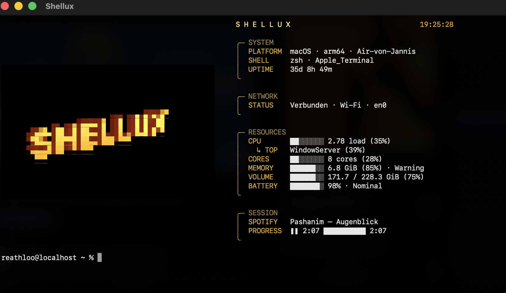
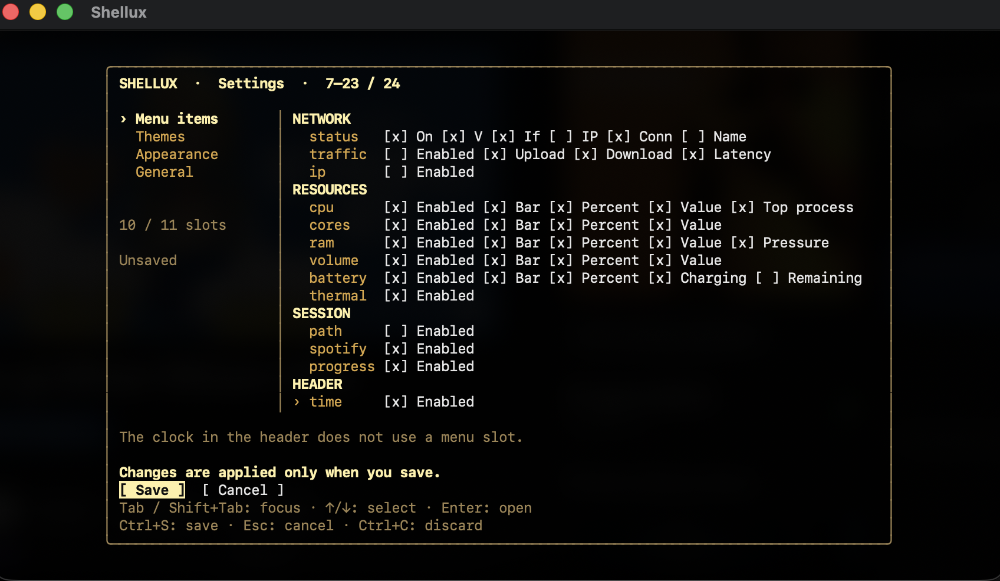

# Shellux

An animated system dashboard for **Zsh and Bash on macOS and Linux**.
System stats, music, and your own look right in the terminal, with your familiar prompt intact.



## Features

- **System overview:** CPU, RAM, storage, battery, network, and more.
- **Flexible display:** Toggle individual items and details such as bars, percentages, and time zones.
- **Your own look:** Animated themes with matching styles and backgrounds. Mix and match or save your own theme.
- **Spotify:** Current track and playback progress on macOS.
- **Visual settings:** Customize everything with your keyboard inside the terminal.

## Installation

Install the latest release with one command:

```sh
curl -fsSL https://raw.githubusercontent.com/reathloo/shellux/main/scripts/install-release.sh | sh
```

The installer detects macOS/Linux and your processor architecture, verifies the
downloaded archive with SHA-256, installs Shellux under `~/.local`, and adds it
to Zsh or Bash. Open a new terminal tab afterward.

For a manual installation, download the archive and `checksums.txt` from
[GitHub Releases](https://github.com/reathloo/shellux/releases), verify the
archive, extract it, and run:

```sh
./install.sh
```

This manual path prints the lines to add to your shell configuration without
changing it automatically.

## Customize

```sh
shellux settings
```

Explore **Menu items**, **Menu layouts**, **Themes**, **Appearance**, **General**,
and **Doctor** to choose what appears, save menu presets, select themes, set custom
colors, and change the refresh interval.
**Menu layouts** shows saved layouts and preset layouts in two columns. The
selection above them switches between automatic detection and manual choice.
**Coding**, **Minimal**, **SSH / Remote**, **Presentation**, **Focus** and **Snapshot** are working presets.
Manual selection works in any directory. Automatic Coding
activates inside a Git repository or a project containing `go.mod`,
`package.json`, `pyproject.toml`, `Cargo.toml`, `pom.xml`, or a Gradle build file.
Changing directories into or out of a Coding project refreshes the header in
the sourced shell. Docker and Kubernetes contexts are displayed when their
tools are available, but do not trigger Coding. Git details appear inside Git
repositories; installed runtimes and the last shell command appear when their
data is available. Coding temporarily uses a compact menu with the CODING
section first. Its selection never changes the chosen theme, animation, style
or background. The saved menu returns when Coding is no longer active.
Automatic Minimal takes precedence when the terminal is narrower than 110
columns or shorter than 18 rows. It shows time, path, optional Git branch,
CPU and memory in a compact list with a small pulsing indicator. The selected
theme remains saved and the usual layout returns as soon as there is room.
Automatic SSH / Remote activates in an incoming SSH shell when `SSH_CONNECTION`,
`SSH_CLIENT` or `SSH_TTY` is set. It takes precedence over Coding, while Minimal
still wins on a small terminal. The preset shows account and host, SSH client
and server endpoints, TTY and terminal type, path, connection status, uptime,
CPU and memory. Identity, SSH link and terminal each have two independent detail
switches under **Menu items → REMOTE**. Missing SSH values show `N/A`; no server
is contacted to fill them in. The preset preserves the selected theme
and restores the usual layout when the SSH session ends. `SSH_AUTH_SOCK` alone
does not count as a remote session; manually selecting Remote also works locally.
Presentation is selected manually before screen sharing or recording. Its
Shellux header shows only date, time, uptime, CPU and memory percentages, and
connected/disconnected status. It hides paths, host and network names, IPs,
Git and tool context, logged-in users, and media metadata. The selected theme
stays unchanged. This controls the Shellux header; your shell prompt and
existing terminal output can still contain private information.
Snapshot is selected manually for bug diagnosis. It captures the current time,
Shellux version, platform, shell, uptime, CPU, memory, load and connection
status in a fixed header. Hostname, path, IP and media details are hidden by
the preset. The values and animation stay still until `shellux reload` captures
a new view. The selected theme stays unchanged. This is a local display, not
an automatically shared bug report.
Focus is selected manually in **Menu layouts**. Choose 15, 25, 30, 45 or 60
minutes, or enter a custom duration from 1 to 240 minutes. During the session,
CPU and memory percentages, Spotify and playback progress remain in the usual
dashboard column. The shaded ASCII clock uses the supplied `#`, `/`, `\\`, `_`
and `|` font in the same 51×26 canvas as other animations. Below one hour it
shows minutes and seconds; from one hour onward it shows hours and minutes.
The colon stays still and there are no additional labels. When the terminal is
too narrow for both columns, the dashboard moves above the centered clock.
The terminal background is black and the header text is white. When the timer
expires, Shellux restores the previous layout selection and the saved theme.
Selecting another layout ends the session early. The timer is saved with an
absolute deadline, so reopening the terminal does not restart it.
**Doctor** checks the installed Zsh/Bash integration, downloaded theme packages,
owner permissions on Shellux files, and orphaned live-renderer processes. Scanning
does not change anything or access the network. A repair is offered only when
Shellux can identify a safe target and requires confirmation; theme repair may
download verified packages, while permission repair never uses administrator
privileges. Open a new terminal tab after repairing the shell integration.
Under **Menu layouts**, save the current menu as a named layout, apply a saved
layout or delete it. A layout includes visible items, detail switches and their
order; it does not change the theme, colors, language or refresh interval.
In **Menu items**, select a section, item or detail switch and press `M` to
reorder it. In move mode, `↑/↓` moves a section or item, and `←/→` moves a detail
switch. Press `Enter` to leave move mode, then save to apply the layout.
You can also move a selected detail switch directly with `Shift+←/→`.
CPU, RAM, network traffic, and battery can each show an optional eight-step
sparkline summarizing the last minute; the existing detail switches remain independent.
Optional rows also include disk read/write throughput, gateway-ping loss with
sample counts, distinct locally logged-in users with names, and microphone/camera
activity. Each has separate detail switches and starts hidden. Media activity is
reported only when macOS exposes device status; otherwise it shows `N/A` (Linux
currently reports `N/A`). Gateway-ping loss is not a measurement of all network
traffic and may reflect blocked ICMP rather than an actual connection problem.
Further optional resource rows show the 1/5/15-minute load averages, used/free
swap, and the GPU model/core count reported by macOS. GPU utilization is not
estimated; unavailable hardware details show `N/A`. The volume row also has
an independent, default-off switch for remaining free space.
The **CODING** section contains five default-off rows: Git branch/repository,
ahead/behind counts against the locally configured upstream, Go/Node/Python/Java
versions, Docker/Kubernetes contexts, and the last command's duration/exit code.
Each row has independent detail switches. Git comparisons use local refs and do
not fetch; missing tools, repositories, upstreams, or shell command data show
`N/A`. Shellux collects these values only when their rows are enabled. Last
command duration has whole-second resolution and requires the sourced Zsh/Bash
integration; the header still waits for an explicit reload after normal command
output.
Under **General → Language**, choose **Automatic (system)**, **English**, or
**Deutsch** for the dashboard and settings. Automatic uses the system/terminal
locale, with English as the fallback for other languages. Commands stay unchanged.



Use the **arrow keys** to navigate, **Tab** to switch sections, and **Space / Enter** to toggle or select.
**Ctrl+S** saves; **Esc** cancels. More keyboard shortcuts appear in the menu.

Changes take effect only when you **Save**, which restarts the header and clears scrollback.
**Cancel** discards your changes. Additional themes download only when you save
and remain available offline afterward. The default theme, general styles, and basic colors are built in.
In **Themes**, press `F` to mark a theme as a favorite (save to keep the change).
Press `U` on an installed catalog theme to uninstall its downloaded files after
confirmation; this takes effect immediately. Switch away from an active theme and
save first. When you open **Themes**, Shellux checks the catalog and automatically
updates already installed packages to newer verified versions. The header itself
does not access the network.

## Everyday use

| Command | Action |
| --- | --- |
| `shx` | Bring back the header and clear scrollback |
| `shellux off` / `shellux on` | Disable or enable the header in the current tab |
| `shellux doctor` | Check your installation |
| `shellux help` | Show all commands |

The header pauses while commands run so their output stays readable and scrollable.
Bring it back with `shx` or `shellux reload`.
Customization commands remain available as an alternative to the settings menu.

## Good to know

- Up to **11 menu slots**; empty categories disappear automatically.
- Some metrics depend on your system and permissions. Unavailable values appear as `N/A`.
- Spotify requires the desktop app and may need macOS Automation permission.
- Thermal shows thermal state, not a temperature in °C. Optional setup with `shellux thermal enable` requires administrator privileges.
- Background colors require a terminal that supports changing them.

## Development

Requires **Go 1.27.2 or later**. On macOS, the Xcode Command Line Tools are also required.
From the cloned repository:

```sh
go mod verify
go run ./tools/theme-pack -check
go test ./...
go test -race ./...
go vet ./...
sh shell/shellux_test.sh
sh scripts/install_test.sh
sh -n scripts/install.sh scripts/install-release.sh
```

[CI](.github/workflows/ci.yml) also tests shell integration and the interactive settings menu on macOS and Linux.

To publish your own theme packages, see the [guide](themes/README.md).

## License

Shellux is licensed under the [PolyForm Noncommercial License 1.0.0](LICENSE).
You may use, modify, and redistribute the code for noncommercial purposes.
Commercial use or sale requires separate permission from the copyright holder.
Shellux is **source-available**, rather than open source in the formal sense.
Rights to third-party graphics and other content remain with their respective owners.
