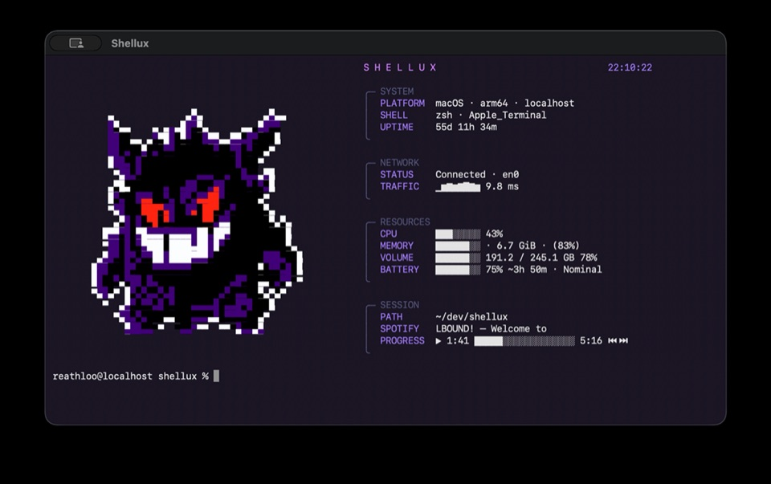
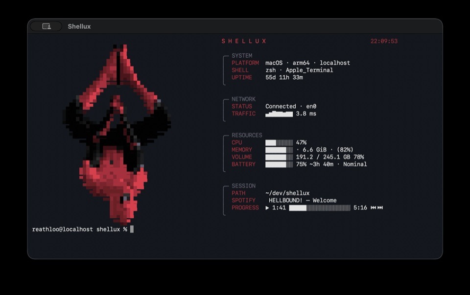
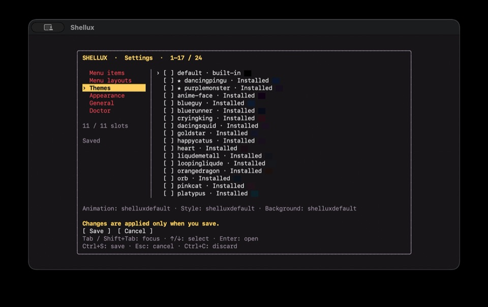

# Shellux

An animated system dashboard for **Zsh and Bash on macOS and Linux**. Shellux
keeps system stats, project context, music, and your own visual style above the
prompt you already use.

[Install](#installation) · [Settings](#settings) · [Profiles](#profiles) ·
[Commands](#everyday-commands) · [Development](#development)

## See Shellux in action

| Theme preview | Theme preview |
| --- | --- |
| [](docs/videos/theme-preview-purple.mp4) | [](docs/videos/theme-preview-red.mp4) |
| [Watch the purple theme](docs/videos/theme-preview-purple.mp4) | [Watch the red theme](docs/videos/theme-preview-red.mp4) |

The previews show real animated themes running in the terminal. Click either
image to watch the video.

## What Shellux offers

- **System overview:** CPU, memory, storage, battery, network, load, swap, and
  optional local metrics.
- **Context-aware layouts:** automatic Coding, Minimal, and SSH profiles plus
  manual Presentation, Focus, and Snapshot modes.
- **Live customization:** preview themes, animations, styles, and backgrounds
  before saving.
- **Terminal-native input:** use keyboard, mouse, or touchpad in Settings; use
  clickable playback controls in sourced Zsh.
- **Local-first operation:** metrics stay local and the live header does not
  access the network.

## Installation

Install the latest release:

```sh
curl -fsSL https://raw.githubusercontent.com/reathloo/shellux/main/scripts/install-release.sh | sh
```

The installer detects your operating system and processor architecture,
verifies the archive with SHA-256, installs Shellux under `~/.local`, and adds
the integration to Zsh or Bash. Open a new terminal tab when it finishes.

<details>
<summary><strong>Manual installation</strong></summary>

Download the archive and `checksums.txt` from
[GitHub Releases](https://github.com/reathloo/shellux/releases), verify and
extract the archive, then run:

```sh
./install.sh
```

The manual installer prints the shell configuration lines instead of changing
your configuration automatically.

</details>

## Settings

Open the visual settings menu:

```sh
shellux settings
```

[](docs/videos/settings-mouse.mp4)

[Watch the Settings and mouse-control demo](docs/videos/settings-mouse.mp4)

### Mouse, touchpad, and keyboard

- Click sections, rows, detail switches, dialogs, **Save**, or **Cancel**.
- Scroll long navigation and content lists with the mouse wheel or touchpad.
- Use arrow keys to navigate, `Tab` to change focus, and `Space` or `Enter` to
  toggle or open controls.
- Press `Ctrl+S` to save or `Esc` to go back or cancel.

### Live previews

- In **Themes**, press `Enter` or click a theme to preview its palette and
  background immediately while staging its matching animation.
- In **Appearance**, animations run directly beside the selector; styles and
  backgrounds update while you browse.
- Previewing only changes the draft. `Ctrl+S` saves it; canceling restores the
  previous theme and terminal background.
- Full animation previews require the theme package locally. Packages selected
  for the first time are downloaded and verified when you save.

> [!IMPORTANT]
> Saving restarts the header and clears scrollback. Canceling discards unsaved
> choices and restores the previous terminal background.

### Available sections

| Section | Purpose |
| --- | --- |
| **Menu items** | Show, hide, preview, and reorder rows and detail switches. |
| **Menu layouts** | Choose automatic/manual profiles and manage saved layouts. |
| **Themes** | Preview, select, favorite, install, update, or uninstall themes. |
| **Appearance** | Combine animations, styles, colors, and backgrounds. |
| **General** | Select language and refresh behavior. |
| **Doctor** | Scan the local installation and offer safe repairs. |

Shellux supports up to **11 visible menu slots**. Empty categories disappear.
Press `M` to move the selected section, row, or detail switch; use the arrow
keys to position it and `Enter` to finish.

## Profiles

Shellux uses one global profile mode: **Automatic** or **Manual**. Manual mode
keeps your selected profile everywhere. Automatic mode chooses from the current
terminal context.

| Profile | Selection | Purpose |
| --- | --- | --- |
| **Standard** | Default | Your normal saved dashboard. |
| **Coding** | Automatic or manual | Git, runtimes, containers, and last-command context. |
| **Minimal** | Automatic or manual | Compact view below 110 columns or 18 rows. |
| **SSH / Remote** | Automatic or manual | Local information about an incoming SSH session. |
| **Presentation** | Manual | Hides sensitive dashboard fields while sharing. |
| **Focus** | Manual | A 1–240 minute timer with essential resources and playback. |
| **Snapshot** | Manual | A fixed local diagnostic view refreshed on request. |

> [!NOTE]
> Automatic priority is **Minimal → SSH / Remote → Coding → Standard**. Profile
> changes preserve the selected theme.

<details>
<summary><strong>Profile details</strong></summary>

- **Coding** activates in Git repositories or projects containing common build
  files such as `go.mod`, `package.json`, `pyproject.toml`, or `Cargo.toml`.
  Docker and Kubernetes can be displayed but do not trigger the profile.
- **Minimal** shows time, path, optional Git branch, CPU, and memory until the
  terminal has enough space again.
- **SSH / Remote** reads `SSH_CONNECTION`, `SSH_CLIENT`, or `SSH_TTY` locally.
  `SSH_AUTH_SOCK` alone does not count, and no server is contacted.
- **Presentation** hides paths, host/network names, IP addresses, Git/tool
  context, local users, and media metadata. Existing output and your prompt may
  still contain private information.
- **Focus** uses an absolute deadline and restores the previous layout when the
  timer ends. Selecting another layout ends it early.
- **Snapshot** freezes system/resource information until `shellux reload`.
  Nothing is shared automatically.

</details>

## Dashboard data

Rows and detail switches are independently configurable. Optional rows start
hidden, unavailable values show `N/A`, and disabled collectors are not probed.

<details>
<summary><strong>Available metrics and context</strong></summary>

- CPU, RAM, network traffic, and battery can show optional eight-step
  sparklines for roughly the last minute.
- Optional resources include disk I/O, gateway-ping loss, local users,
  microphone/camera activity, load averages, swap, GPU information, and free
  disk space.
- Coding rows cover Git repository/branch, local ahead/behind counts, Go, Node,
  Python, Java, Docker, Kubernetes, and last-command duration/exit code.
- Git comparisons use local refs and never fetch. Gateway-ping loss may also
  indicate blocked ICMP rather than a broken connection.
- Thermal reports a state rather than a temperature. Optional setup with
  `shellux thermal enable` requires administrator privileges on macOS.

</details>

## Mouse controls in the live dashboard

In sourced Zsh, Shellux accepts mouse input while the prompt is idle:

- click play/pause, the progress bar, previous, or next for Spotify;
- hover a letter in **S H E L L U X** to highlight it;
- hold `Shift` when selecting text in terminals that reserve normal dragging
  for mouse reports.

Mouse reporting is disabled before commands and full-screen applications run.
Bash Readline cannot safely route dashboard clicks, so Bash uses the keyboard
panel from `shellux spotify`; press `T` there to toggle playback.

## Themes and offline use

Downloaded themes remain available offline. Press `F` in **Themes** to favorite
a theme or `U` to uninstall an inactive downloaded theme after confirmation.
Opening **Themes** checks installed packages for verified catalog updates; the
live header itself stays offline.

To create and publish theme packages, see the [theme guide](themes/README.md).

## Language and Doctor

Under **General → Language**, select **Automatic (system)**, **English**, or
**Deutsch**. Automatic follows the system or terminal locale and falls back to
English. Command names remain unchanged.

`shellux doctor` checks shell integration, theme packages, file ownership, and
orphaned renderer processes locally without changing anything or accessing the
network. Repairs are offered only for safe targets and require confirmation;
permission repair never uses administrator privileges.

## Everyday commands

| Command | Action |
| --- | --- |
| `shx` | Bring back the header and clear scrollback. |
| `shellux settings` | Open visual Settings. |
| `shellux reload` | Restart the live header. |
| `shellux off` / `shellux on` | Hide or restore the header in this tab. |
| `shellux status` | Show theme and refresh settings. |
| `shellux doctor` | Check the local installation and renderer state. |
| `shellux spotify` | Open keyboard-driven Spotify controls. |
| `shellux help` | List all commands and customization options. |

The header pauses while commands run so their output remains readable. Bring it
back with `shx` or `shellux reload`.

## Development

Development requires **Go 1.27.2 or later** and, on macOS, the Xcode Command
Line Tools.

```sh
go mod verify
go run ./tools/theme-pack -check
go test ./...
go test -race ./...
go vet ./...
sh shell/shellux_test.sh
sh scripts/install_test.sh
sh -n scripts/install.sh scripts/install-release.sh
```

[CI](.github/workflows/ci.yml) also builds Shellux and tests shell integration,
profiles, Settings, mouse routing, and concurrent rendering on macOS and Linux.

Shellux is source-available under the
[PolyForm Noncommercial License 1.0.0](LICENSE). Commercial use or sale requires
separate permission from the copyright holder.
